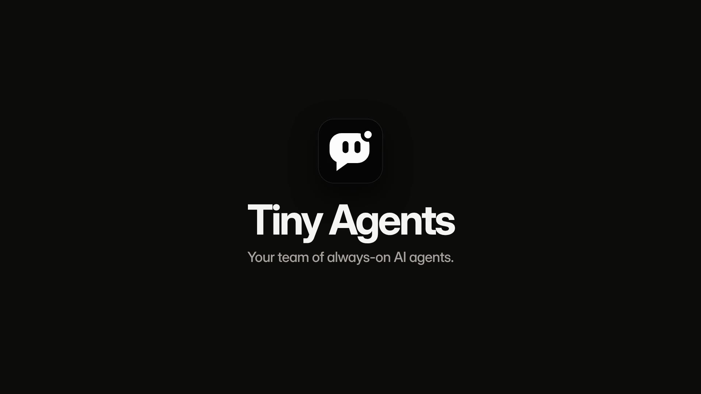

# tiny-agents

A messenger-style app where every contact is an AI bot you chat with — built
on [pi-durable](https://earendil.com/posts/pi-durable/) for durable
conversations (survive refreshes, crashes, redeploys) and the
[groot](https://github.com/AshikNesin/groot) boilerplate (Hono + React 19 +
Drizzle/SQLite + JWT/passkey auth, Node only). Models are set up in the app
(Settings → Models): Anthropic, OpenAI, Gemini, any OpenAI-compatible host,
Cloudflare AI Gateway or your Claude plan, with keys kept in the vault.

See `PRD.md` for the full spec. Phase 1: create bots, chat with streamed
replies, durability as a first-class property.

## Demo

[](docs/demo/tiny-agents-teaser.mp4)

**In 50 seconds:** a trip to Japan from Chennai, planned by a bot that
remembers you, browses and uses its own computer, and pays only after you
approve (card filled from the Vault). You set each tool to Allow, Ask or Off,
open a real shell on the sandbox, connect your tools over MCP, get alerts when
a bot needs you, watch bots hand work to each other, and see a reply survive a
server restart. See [`scripts/demo/teaser/`](scripts/demo/teaser/README.md) to
re-render it. A one-page marketing site lives in [`site/`](site/README.md).

[](docs/demo/tiny-agents-demo.mp4)

A 1:39 tour: bots that ask before they act, a live browser (Google Flights,
Chennai → Bangalore), a real terminal on the sandbox VM, routines, and
conversations that survive a refresh. Recorded from the real app with scripted
chat replies; see [`scripts/demo/`](scripts/demo/README.md) to re-record it.

## Development

```sh
pnpm install
pnpm dev          # https://tiny-agents.localhost (demo@example.com / demo@example.com)
```

No `.env` is needed for development; `.env.example` lists every variable. The
dev server runs under [portless](docs/guides/portless-https.md);
`PORTLESS=0 pnpm dev` serves `http://localhost:3000` instead.

For real inference, sign in and add a provider in **Settings → Models**
(set `SECRETS_KEY` first: keys are kept in the vault). No restart; see
[`docs/features/models.md`](docs/features/models.md). With no model set up
the app runs but shows a banner and disables sending. For UI/flow work
without a provider: `TINY_AGENTS_FAUX=1 pnpm dev` uses a scripted echo model
(send `/ask` to see a bot's questions for you).

Web search and page reading use
[TinyFish](https://www.tinyfish.ai/blog/search-and-fetch-are-now-free-for-every-agent-everywhere)
(`TINYFISH_API_KEY`, from [agent.tinyfish.ai](https://agent.tinyfish.ai)).
Search and Fetch are free; without the key those tools stay hidden.

## Use your Claude subscription (experimental)

A bot can answer on a Claude Pro or Max plan. tiny-agents installs and
runs Claude Code on your sandbox; you add the Claude plan account in
Settings → Models and sign in once from Settings → Models → Claude plan. Claude Code holds the
login on the sandbox. tiny-agents does not: it will not read, store, or
refresh that credential, and it will not proxy Anthropic.

This is easy to get wrong in a way that risks the Claude account.
Anthropic has restricted third-party use of subscription access. Read
[docs/claude-subscription.md](docs/claude-subscription.md) before enabling
it. Short version:

- Don't add the Claude plan account until you have read that page.
- Do not paste an `sk-ant-oat` token anywhere in this app. It is refused.
- The worker listens on the sandbox's `127.0.0.1` and the app reaches it
  through its SSH tunnel; nothing is published.
- Pick a model labelled "uses your Claude plan", or keep using API-key providers.
- To spend Max-plan API credits without this engine, put a normal console
  API key in Cloudflare AI Gateway BYOK only. See
  [docs/features/models.md](docs/features/models.md).

## Layout

- `packages/agent` — the only module that touches pi-durable (excluded from
  groot sync; app-shaped API so pi-durable churn stays contained). The
  Claude plan client lives under `src/engines/claude-code/`. The sandbox
  connection, terminal, browser, computer and Claude worker, which do not
  use pi-durable, are subpaths (`@tiny-agents/agent/sandbox` and so on; see
  [docs/README.md](docs/README.md#tiny-agentsagent-entry-points))
- `packages/claude-worker` — loopback daemon that drives Claude Code. It
  does not run inside the tiny-agents process
- `packages/code` — the Code page's harness adapters: one contract every
  coding agent plugs into (Shelley, Claude Code), with the built-in drivers
- `apps/web` — app code (bots API + SSE under `src/server/api/bots`, chat UI
  under `src/client`); everything else is the groot boilerplate, synced via
  `pnpm groot:sync` and never edited here
- `app.db` (Drizzle, schema in `apps/web/src/server/db/schema.ts`) and
  `agent.db` (pi-durable) are separate SQLite files; the link is
  `bots.conversationId`

## Testing

```sh
pnpm test         # server (incl. agent runtime + SIGKILL durability suite)
pnpm test:client  # client unit tests
pnpm test:e2e     # Playwright (runs on the faux provider)
```

## Deployment

Coolify (Railpack, health check `/health`, one volume at `/app/data`, SQLite
`DATABASE_URL=file:/app/data/app.db`, `AGENT_DB_PATH=/app/data/agent.db`).
**Disable rolling updates** (consistent container naming) — pi-durable allows
only one process per agent store. In-flight replies resume after boot.

Migrations apply on boot. Uploads live next to the database
(`/app/data/uploads`) unless `UPLOADS_DIR` is set. Production requires
`JWT_SECRET_KEY` (≥ 32 chars), `ADMIN_AUTH_KEY`, `ORIGIN` and `RP_ID`; the
server refuses the development defaults.

**Upgrading from the Prisma build:** the first boot finds the old database,
renames it to `app.db.prisma-backup-<time>` and copies every row into the new
layout (bots, chats, vault items, routines, memories, users, passkeys,
settings). Routines re-arm their next run. Passwords keep working: the first
sign-in replaces the old bcrypt hash. Keep the backup until you have checked
the app, then delete it.
