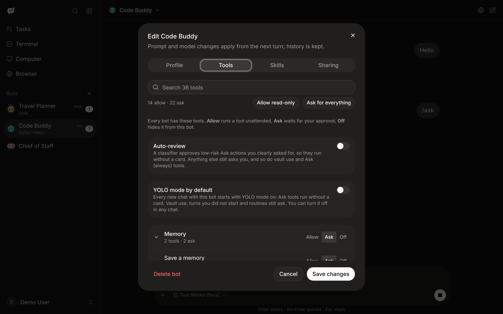
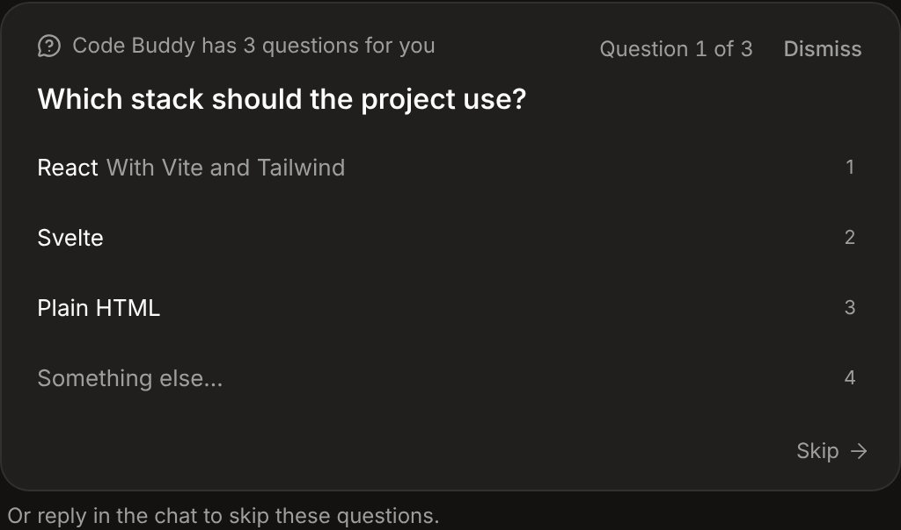

# tiny-agents

A self-hosted personal assistant: a messenger where each contact is an AI bot
that can browse the web, run commands on a sandbox and work on a schedule, and
asks you before it acts. For people who want an assistant they run and control
themselves.

[](https://github.com/AshikNesin/tiny-agents/actions/workflows/test.yml)



## Why it exists

tiny-agents is Ashik's own personal assistant, built to solve his own
problems, on the belief that everyone should have a personal assistant they
fully control. It runs on your server with your data in SQLite files, works
with the model provider you choose, and lets you set each tool a bot has to
Allow, Ask or Off. Conversations are durable: a reply survives a page refresh,
a crash or a redeploy.

<table>
  <tr>
    <td width="50%"></td>
    <td width="50%"></td>
  </tr>
  <tr>
    <td>A bot asks when it needs your input.</td>
    <td>Routines run a bot on a schedule.</td>
  </tr>
</table>

## Quick start

Prerequisites: Node.js 24, pnpm 10 (`corepack enable` gives you the pinned
version), git, and [portless](docs/guides/portless-https.md), which `pnpm dev`
runs through.

1. Install portless:

   ```sh
   npm install -g portless
   ```

2. Clone and install:

   ```sh
   git clone https://github.com/AshikNesin/tiny-agents.git
   cd tiny-agents
   pnpm install
   ```

3. Start the app with the built-in test model (no keys, no network):

   ```sh
   TINY_AGENTS_FAUX=1 pnpm dev
   ```

4. Open the URL it prints (`https://tiny-agents.localhost`, or
   `https://tiny-agents.localhost:8888` when no portless proxy was already
   running) and sign in with `demo@example.com` / `demo@example.com`.
5. Click **New bot**, type a name and click **Create bot** (the model is
   already **Test Model (faux)**). Send `Hello`; the bot replies
   `Echo: Hello`.

The first run creates `data/dev.db`, applies migrations and seeds the demo
user. No `.env` is needed; [`.env.example`](.env.example) lists every
variable. `PORTLESS=0` serves `http://localhost:3000` instead of the HTTPS
URL, but the `portless` command must still be installed.

## Usage

### Use a real model

Model keys are kept in the vault, so set `SECRETS_KEY` first, then restart
without `TINY_AGENTS_FAUX`:

```sh
echo "SECRETS_KEY=$(openssl rand -base64 32)" >> .env
pnpm dev
```

Add a provider account in **Settings → Models**: Anthropic, OpenAI, Gemini,
any OpenAI-compatible host, Cloudflare AI Gateway or your Claude plan. No
restart is needed. See [docs/features/models.md](docs/features/models.md).
Using a Claude Pro or Max plan is experimental and can put the Claude account
at risk; read [docs/claude-subscription.md](docs/claude-subscription.md)
before you turn it on.

### Create a bot and chat over the API

Everything the web app does goes through the same HTTP API. With
`PORTLESS=0 TINY_AGENTS_FAUX=1 pnpm dev` running:

```sh
B=http://localhost:3000/api/v1
T=$(curl -s -X POST $B/auth/login -H 'content-type: application/json' \
  -d '{"email":"demo@example.com","password":"demo@example.com"}' \
  | node -pe 'JSON.parse(require("fs").readFileSync(0)).data.token')
ID=$(curl -s -X POST $B/bots -H "authorization: Bearer $T" -H 'content-type: application/json' \
  -d '{"name":"Helper","modelId":"test-model"}' \
  | node -pe 'JSON.parse(require("fs").readFileSync(0)).data.id')
curl -s -X POST $B/bots/$ID/messages -H "authorization: Bearer $T" -H 'content-type: application/json' \
  -d '{"requestId":"first-message-1","text":"Hello"}'; echo
sleep 2
curl -s $B/bots/$ID -H "authorization: Bearer $T" | grep -o '"lastMessagePreview":"[^"]*"'
```

The last line prints `"lastMessagePreview":"Echo: Hello"`. More recipes are in
[docs/reference/api-requests.md](docs/reference/api-requests.md).

### Run a bot on a schedule

Open **Routines** and click **New routine** to have a bot run a prompt on a
schedule. Each run starts with fresh context and reports back to you. See
[docs/features/routines.md](docs/features/routines.md).

### Connect your tools over MCP

Open **Connections** and click **Add connection** to add a remote MCP server.
Its tools become available to the bots you turn it on for, and each tool can
be switched off. See [docs/features/connections.md](docs/features/connections.md).

### Run it for real

- On your own machine, `pnpm local` builds and runs the production server and
  lets you update from **Settings → Updates**. See
  [docs/guides/local-updates.md](docs/guides/local-updates.md).
- On a server, deploy with Railpack on Coolify or Railway. Run exactly one
  replica with a persistent volume. See [docs/guides/deploy.md](docs/guides/deploy.md).

The browser, computer and terminal tools need a sandbox VM (`SANDBOX_HOST`);
[docs/guides/local-sandbox.md](docs/guides/local-sandbox.md) runs one as a
Docker container. The Android app is in [`mobile/`](docs/features/mobile-app.md).

## Configuration

Settings live in environment variables. Every variable has a development
default, so a fresh checkout needs none. Copy `.env.example` to `.env` to
override. The most common ones:

| Variable           | Type         | Default (development)                | Description                                                                                         |
| ------------------ | ------------ | ------------------------------------ | --------------------------------------------------------------------------------------------------- |
| `PORT`             | number       | `3000`                               | HTTP port                                                                                           |
| `DATABASE_URL`     | string       | `file:./data/dev.db`                 | App SQLite file. Production default is `app.db` under `DATA_DIR` (`/data`)                          |
| `AGENT_DB_PATH`    | string       | `./data/agent.db`                    | pi-durable agent store. Production default `/data/agent.db`                                         |
| `SECRETS_KEY`      | string       | unset                                | Encrypts vault items and connection secrets. Required before adding a model key                     |
| `JWT_SECRET_KEY`   | string       | a development key                    | Signs sessions. At least 32 characters; required in production                                      |
| `ADMIN_AUTH_KEY`   | string       | `dev-only-admin-key`                 | `X-Admin-Auth-Key` header value for admin endpoints; required in production                         |
| `ORIGIN`, `RP_ID`  | string       | `http://localhost:3000`, `localhost` | Public URL and passkey domain; required in production                                               |
| `SANDBOX_HOST`     | string       | unset (no sandbox)                   | Sandbox VM for commands, browser, computer and terminal. Production default `tiny-agents-vm`        |
| `TINYFISH_API_KEY` | string       | unset                                | Turns on web search and page reading (free key from [agent.tinyfish.ai](https://agent.tinyfish.ai)) |
| `TINY_AGENTS_FAUX` | `1` or unset | unset                                | Development and e2e only: use a scripted echo model instead of a provider                           |
| `LOG_LEVEL`        | enum         | `debug` (`info` in production)       | `trace`, `debug`, `info`, `warn`, `error`, `fatal` or `silent`                                      |

The full list, with production rules, is in the
[setup guide](docs/setup-guide.md#environment-variables). Models are not
configured with variables; add them in **Settings → Models**.

## Development

```sh
git clone https://github.com/AshikNesin/tiny-agents.git
cd tiny-agents
pnpm install          # also installs the git hooks
pnpm dev              # dev server with hot reload
pnpm test             # server tests
pnpm test:client      # client tests
pnpm lint             # lint
pnpm verify:static    # the static gates CI runs (lint, types, doc refs, ...)
```

Use pnpm, not npm or yarn. Start with [docs/README.md](docs/README.md) for
guides, [docs/guides/testing.md](docs/guides/testing.md) for how tests are
written, and [docs/reference/workspace-layout.md](docs/reference/workspace-layout.md)
for what each package holds. Projects whose ideas shaped tiny-agents are in
[CREDITS.md](CREDITS.md).

## Contributing

See [CONTRIBUTING.md](CONTRIBUTING.md).

## License

MIT. See [LICENSE](LICENSE).
