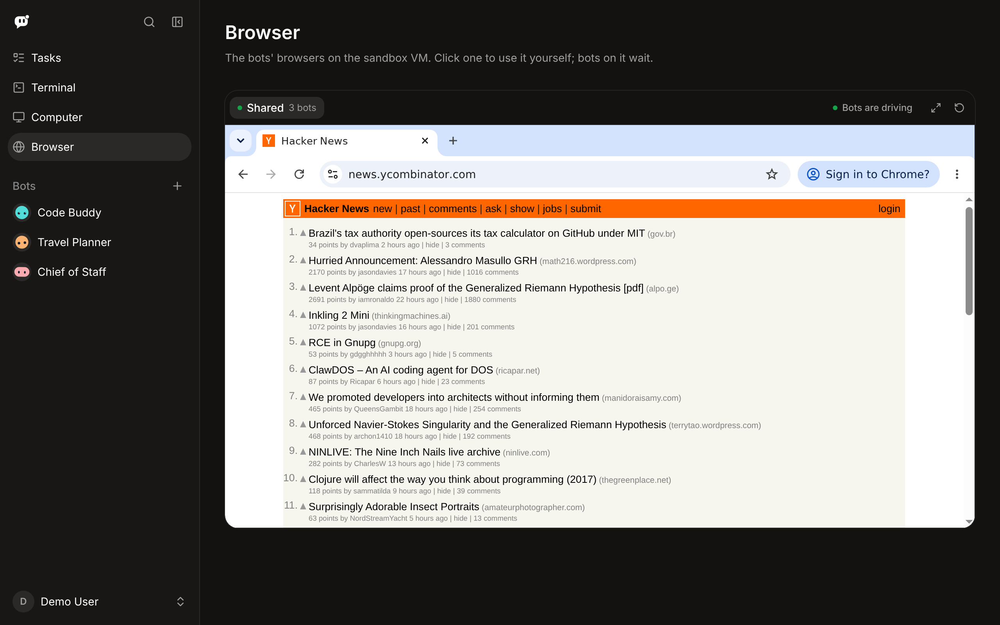
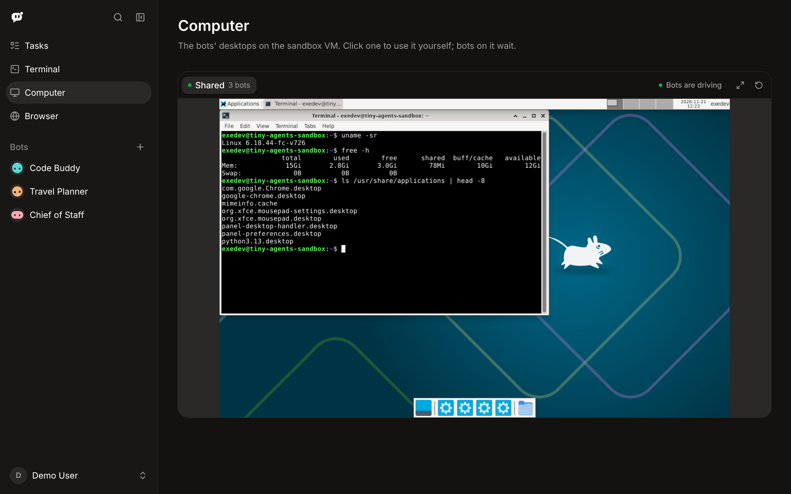
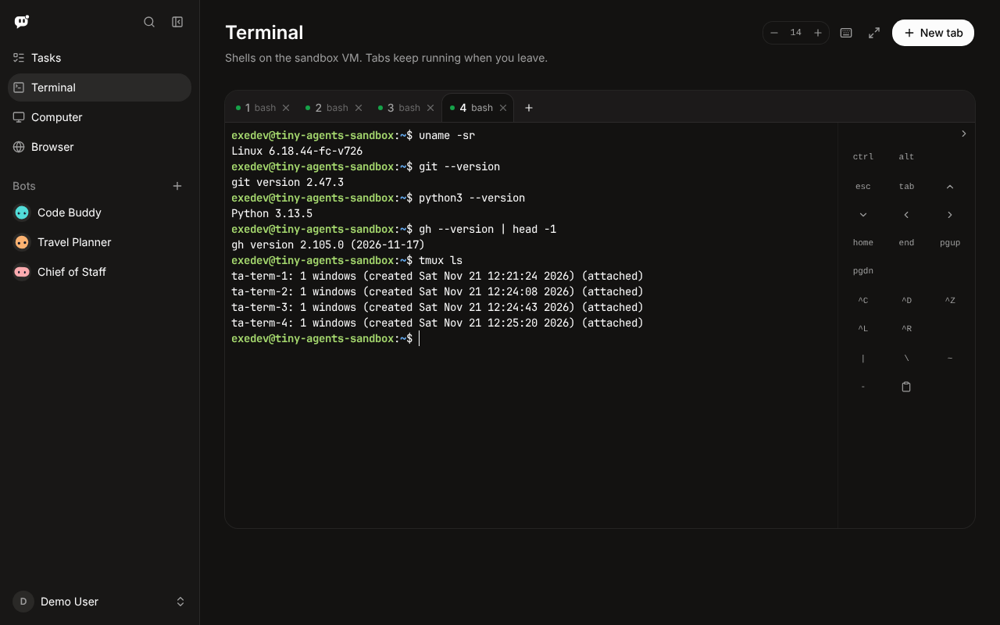
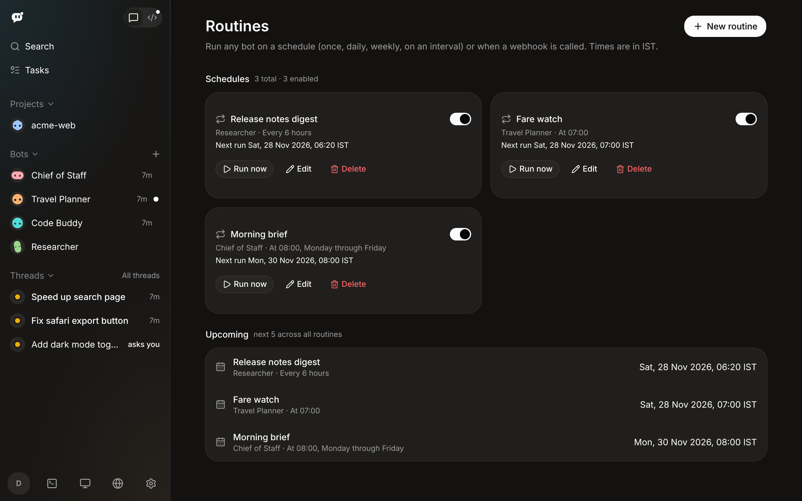

# tiny-agents

Your own AI assistant, on your own server. tiny-agents is a messenger where
each contact is a bot that can browse the web, run commands, work on a
schedule and remember you, and it asks before it does anything you haven't
allowed.

https://github.com/user-attachments/assets/906ab28e-d438-4205-a03a-6e501a60b9eb

## Why

I built tiny-agents to solve my own problems, and I think everyone should have
a personal assistant they fully control. Your data stays in SQLite files on
your machine, you pick the model provider, and you decide what each bot may do
without asking.

## What a bot can do

- **Ask before acting.** Set each tool to Allow, Ask or Off. Approve from the
  web app, a push notification or the Android app.
- **Use a real browser and computer.** A bot drives its own Chrome and, on a
  sandbox VM, a full desktop. You can watch live and take over.
- **Run on a schedule.** Routines run a bot's prompt once, daily, weekly or on
  an interval, and report back.
- **Remember you.** Per-bot memory, and a vault that fills logins and cards
  without the model seeing them.
- **Connect your tools.** Add any remote MCP server.
- **Hand off code.** The Code page drives coding agents (Claude Code, Shelley)
  and their pull requests.

<table>
  <tr>
    <td width="50%"></td>
    <td width="50%"></td>
  </tr>
  <tr>
    <td>Browser: watch a bot's Chrome live, or take over.</td>
    <td>Computer: a full desktop the bots share with you.</td>
  </tr>
  <tr>
    <td width="50%"></td>
    <td width="50%"></td>
  </tr>
  <tr>
    <td>Terminal: shells on the sandbox that keep running.</td>
    <td>Routines: run a bot on a schedule.</td>
  </tr>
</table>

## Try it in two minutes

You need Node.js 24 and pnpm 10.

```sh
git clone https://github.com/AshikNesin/tiny-agents.git
cd tiny-agents
pnpm install
TINY_AGENTS_FAUX=1 pnpm dev
```

Open the URL it prints, sign in with `demo@example.com` /
`demo@example.com`, click **New bot**, and say hello. `TINY_AGENTS_FAUX=1`
runs a built-in test model that echoes you, so no API key is needed.

## Use a real model

Model keys live in the encrypted vault, so give it a key, then restart
without the test model:

```sh
echo "SECRETS_KEY=$(openssl rand -base64 32)" >> .env
pnpm dev
```

Then add a provider in **Settings → Models**: Anthropic, OpenAI, Gemini, any
OpenAI-compatible host, Cloudflare AI Gateway or your Claude plan
([read this first](docs/claude-subscription.md)).

## Run it for good

- **On your laptop:** `pnpm local` runs the production build and updates
  itself from **Settings → Updates**
  ([guide](docs/guides/local-updates.md)).
- **On a server:** deploy with Railpack on Coolify or Railway, one replica
  with a persistent volume ([guide](docs/guides/deploy.md)).

The terminal, the desktop and the live browser view need a sandbox VM; you
can [run one in Docker](docs/guides/local-sandbox.md). Every setting is in
[`.env.example`](.env.example) and the [setup guide](docs/setup-guide.md).

## Android app

The Android app approves requests and chats with your bots from your phone.
It is coming to the Play Store soon; until then,
[download the APK directly](https://release-hub.nesin.io/apps/tiny-agents/download?channel=direct).

## Contribute

See [CONTRIBUTING.md](CONTRIBUTING.md); guides start at
[docs/README.md](docs/README.md). Projects that shaped tiny-agents are in
[CREDITS.md](CREDITS.md).

## License

MIT. See [LICENSE](LICENSE).
