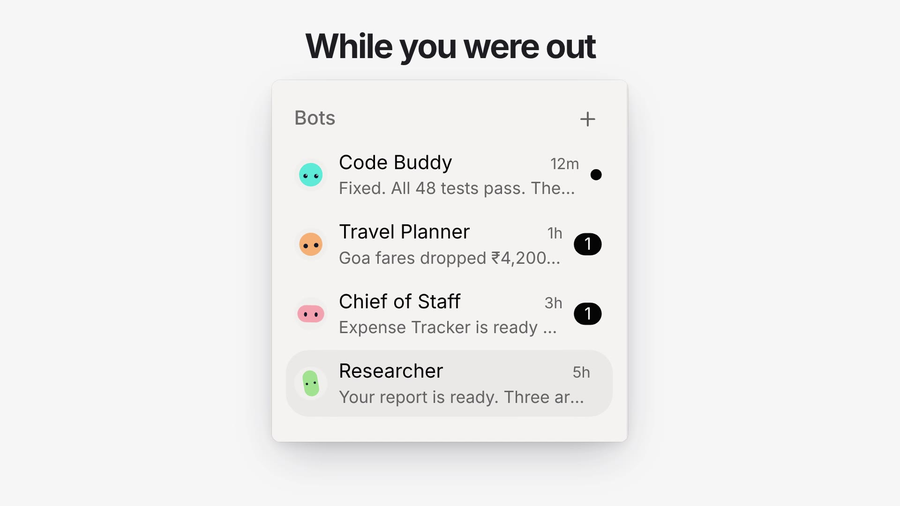
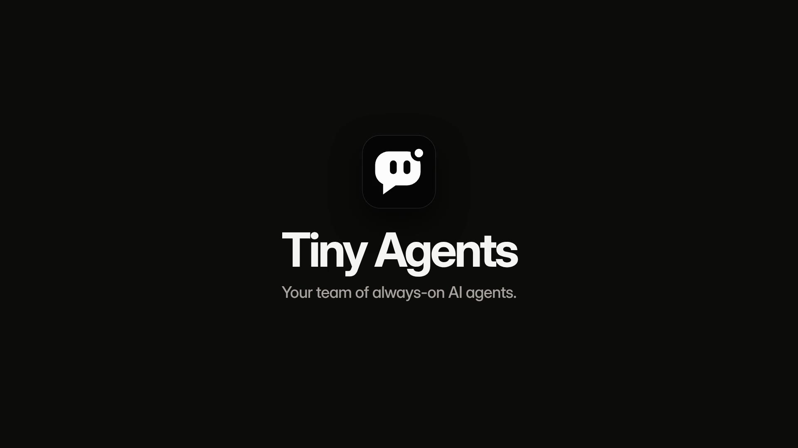
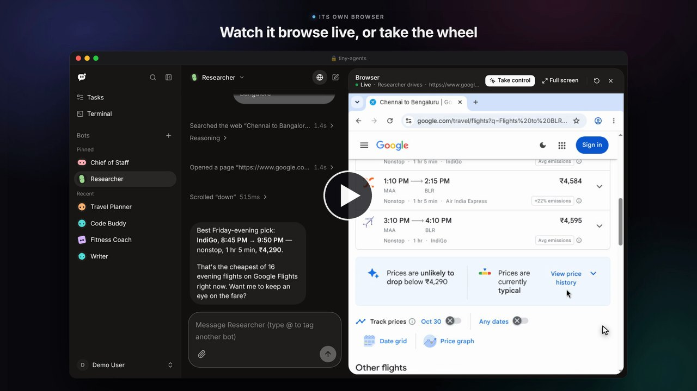

# Demo films

Every screen in these films is the app's own UI.

## Launch film (1:16)

**In 76 seconds:** an evening of catching up. Code Buddy handed a flaky test to
Claude Code and reports back with the fix and its cost; Travel Planner's 7 AM
routine found a fare in its own browser (click the stream to take control) and
asks before paying, approved from the Android app with the card filled from the
Vault; Chief of Staff makes a new bot on request; a friend joins a shared chat;
then memory, a real terminal, MCP connections, any model, YOLO mode and
one-click updates. Also cut as a [vertical video](tiny-agents-launch-vertical.mp4)
and a [15-second teaser](tiny-agents-launch-teaser.mp4). See
[`scripts/demo/launch/`](../../scripts/demo/launch/README.md) for how it was
made and what is staged.

## Teaser (0:50)

**In 50 seconds:** a trip to Japan from Chennai, planned by a bot that
remembers you, browses and uses its own computer, and pays only after you
approve (card filled from the Vault). You set each tool to Allow, Ask or Off,
open a real shell on the sandbox, connect your tools over MCP, get alerts when
a bot needs you, watch bots hand work to each other, and see a reply survive a
server restart. See [`scripts/demo/teaser/`](../../scripts/demo/teaser/README.md)
to re-render it. A one-page marketing site lives in [`site/`](../../site/README.md).

## Tour (1:39)

Bots that ask before they act, a live browser (Google Flights, Chennai to
Bangalore), a real terminal on the sandbox VM, routines, and conversations
that survive a refresh. Recorded from the real app with scripted chat replies;
see [`scripts/demo/`](../../scripts/demo/README.md) to re-record it.
